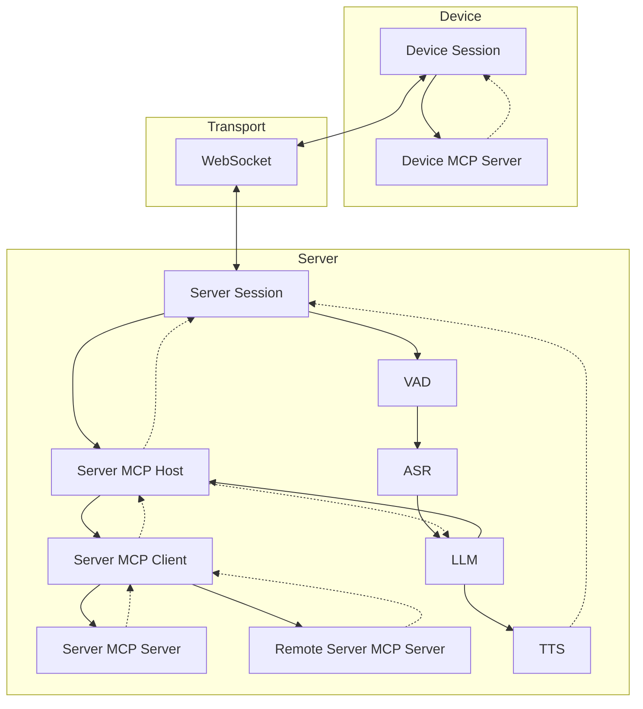
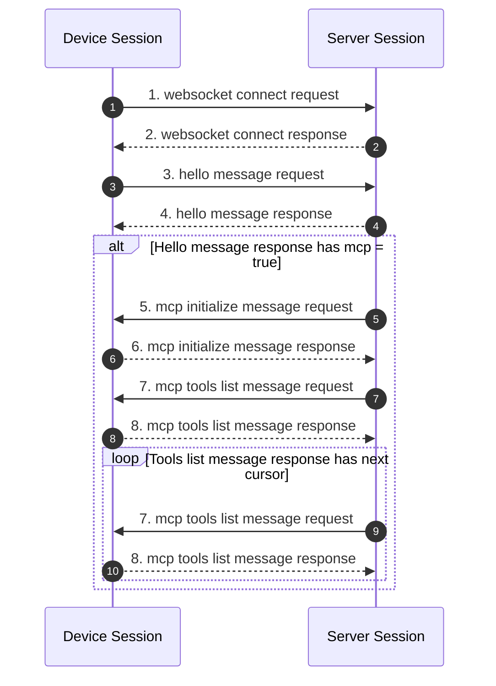
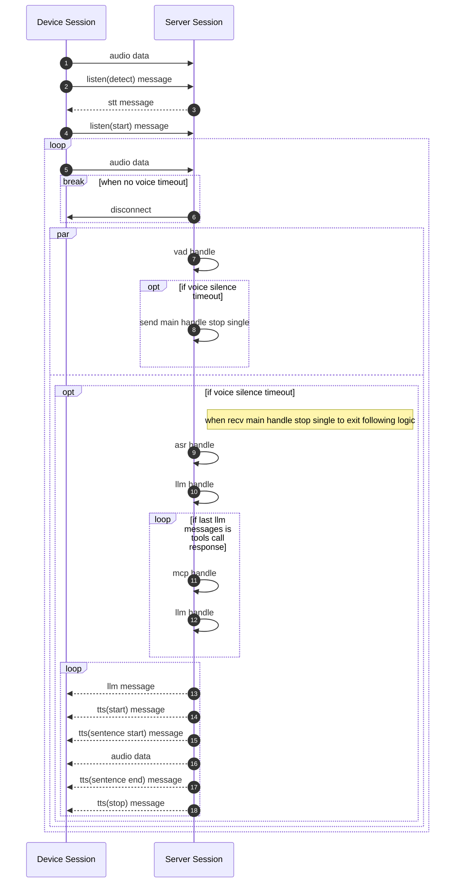
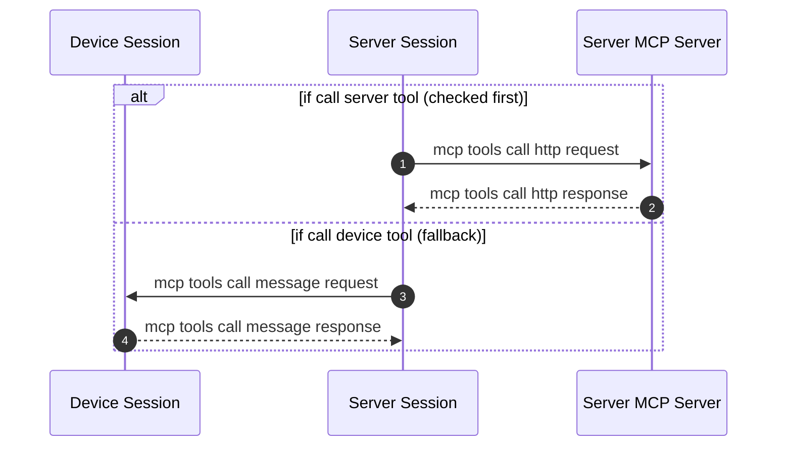

+++
title = "Dialogue Flow"
weight = 204
[extra]
source_file_hash = "e70166d91de3aff0d2d285fee6044331fb62a235"
translated_at = "2026-10-25T00:00:00Z"
+++

# Dialogue Flow

### Handshake Phase

### Communication Phase

### Listen Modes

The listen mode is decided by the **`mode` field on the `listen(start)` frame** (`auto`/`manual`/`realtime`, mapped to `barge_in` + `is_voice_break_detect`), not by a global Hello field. All three modes share the same node chain (`opus→vad→asr→turn→ling→tts`).

#### Auto

The device sends audio continuously; the server decides the utterance is over via silence confirmation, then runs ASR + LLM + TTS. The default for hands-free conversation.

#### Manual

The server **never answers early**: the device controls when audio starts and stops, receiving on `listen(start)` and committing only on `listen(stop)`. While the button is held the ASR node keeps feeding frames to pre-decode but emits no partials and performs no silence confirmation, so a mid-hold pause cannot truncate the utterance and recognition lands almost instantly on release (the decode was spread across the hold). With no speech it prompts once via `EmptyKind::Manual`; see [Empty-Input Behavior](#empty-input-behavior). Mechanics are in [VAD and Turn Detection](@/development/server/vad.en.md).

#### Realtime

Low-latency mode: VAD onset immediately starts LLM inference and TTS streaming without waiting for silence confirmation. Suited to real-time devices like the ESP32.

### Empty-Input Behavior {#empty-input-behavior}

Empty input (no valid speech) is classified by the hub (Session) and prompted at graded levels; the generation layer only renders wording — a "hub decides, NLG renders" split: the Session classifies, counts and decides, while `Ling` / Echo only words the `Act`. Classification uses mode + previous turn:

| kind | Criterion | Behavior |
| --- | --- | --- |
| `Manual` | push-to-talk: `ListenStop` with no speech detected (`!is_voice_break_detect` and `!speech_active`) | one prompt per keypress ("didn't catch that, please repeat"), then back to listening |
| `Wake` | empty input on the first listen after the wake word (`Input{mode:Wake}`) | guiding prompt ("what can I help you with?"), escalating, back to idle after 3 |
| `AutoSpoke` | hands-free auto: VAD triggered but ASR text empty (`asr_node` emits `EmptyInput`) | "didn't catch that, please repeat" → give an actionable example → graceful close |
| `Silence` | hands-free auto/realtime total silence: VAD never triggered, no ASR stream (`Nothing`) | gentle guide with no blame, escalating, back to idle after 3 |
| `Continuing` | empty input while listening again after a reply (realtime `Speaking→Listening`) | silent wait, no repeated prompting, back to idle on timeout |

**Counting (Rule of three)**: the Session keeps `empty_count`, incrementing on every `EmptyTurn` and resetting on real input (`TurnComplete`); it converges after at most 3. `Manual` is the exception: event-driven, it prompts once per voiceless keypress and then resets, not limited to 3.

**Decision**: after observing `(After, EmptyInput)` / `(After, EmptyTurn)` the Session emits one of three actions — `Prompt{kind, count}` re-injected at the chain head (nodes pass the unrecognised event through, `Ling` renders the wording), `Silence` with no expression injected (silent wait / back to idle), or `GiveUp` back to `Idle`. A real LLM composes its prompt from the Act; the Echo model returns a graded fixed sentence by kind/count.

The `Manual` prompt has exactly one source: in manual mode `finish_stream` returns `Nothing` when VAD detected no speech, so `EmptyKind::Manual` drives it and no double-trigger with the in-chain `EmptyInput` is possible. ASR-side outcomes and thresholds are in [VAD and Turn Detection](@/development/server/vad.en.md).

### MCP Handle

Detailed protocol field definitions can be found in [WebSocket Protocol](@/development/server/websocket-protocol.en.md).
