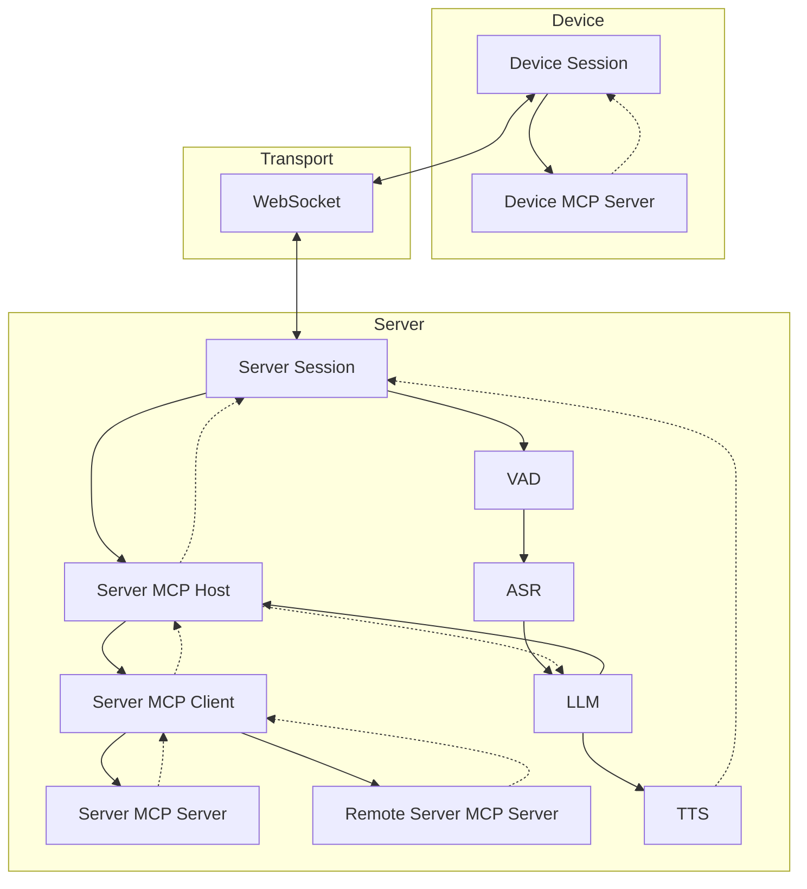
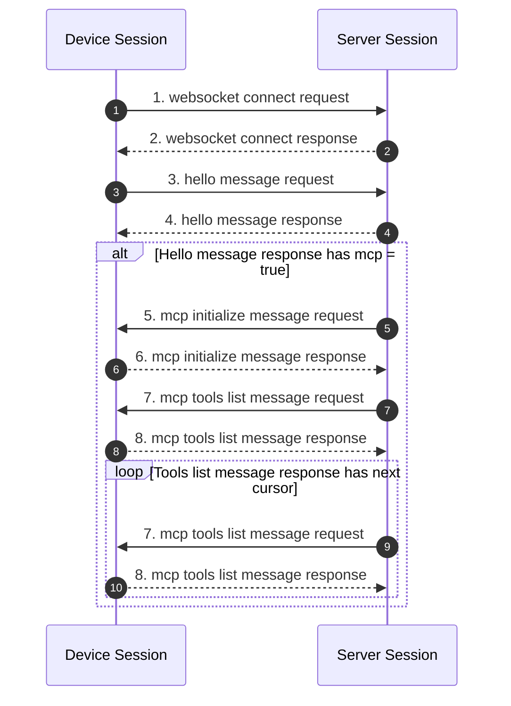
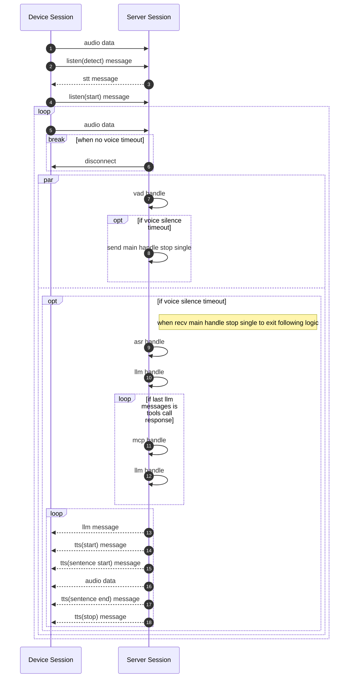
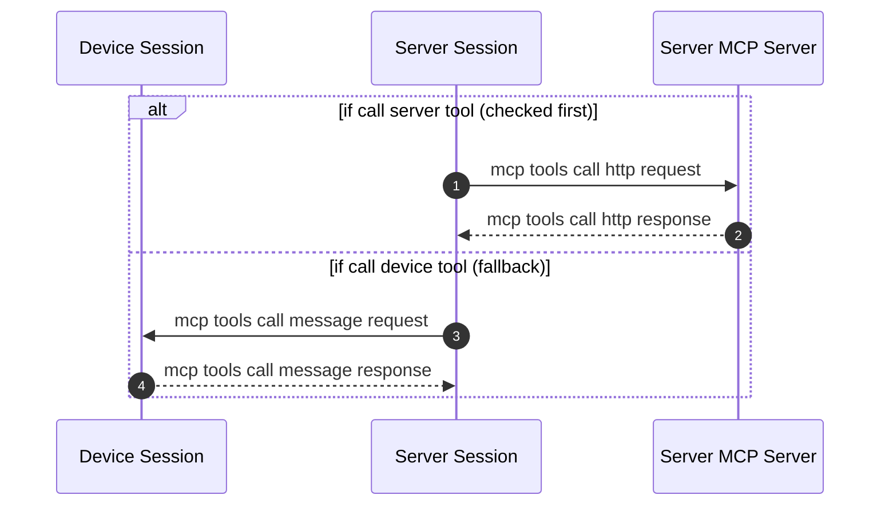

+++
title = "对话流程"
weight = 204
+++

# 对话流程

### 握手阶段

### 通讯阶段

### Listen mode

监听模式由 **`listen(start)` 帧的 `mode` 字段**决定（`auto`/`manual`/`realtime` 映射为 `barge_in` + `is_voice_break_detect`），并非来自 Hello 的全局字段。三种模式共用同一条节点链（`opus→vad→asr→turn→ling→tts`）。

#### Auto

设备持续发送音频 → 服务器按静默确认自动判定说完 → ASR + LLM + TTS。免提对话的默认模式。

#### Manual

服务器**不抢答**：设备控制语音发送的起止，`listen(start)` 开始接收，`listen(stop)` 才成文。按住期间 ASR 逐帧喂流预解码但不发 partial、不做静音确认，所以中途停顿不会被截断，松开后识别几乎瞬时（解码已摊在按住期间）。无人声时按 `EmptyKind::Manual` 提示一次，见[空输入行为](#空输入行为)。机制细节见 [VAD 与回合判定](@/development/server/vad.md)。

#### Realtime

低延迟模式：VAD 检测到语音即开始 LLM 推理与 TTS 流式输出，不等静默确认。适合 ESP32 等实时设备。

### 空输入行为

空输入（无有效语音）由中枢（Session）辨别类型并分级提示，生成层只渲染文案——「中枢决策、NLG 渲染」分层：Session 负责判别 + 计数 + 决策，`Ling` / Echo 只按 `Act` 措辞。判别依据是模式 + 前一 turn：

| kind | 判定条件 | 行为 |
| --- | --- | --- |
| `Manual` | push-to-talk：`ListenStop` 且未检出语音（`!is_voice_break_detect` 且 `!speech_active`） | 每次按键播 1 次引导（"没听到，请再说"），之后回监听等待 |
| `Wake` | 唤醒词（`Input{mode:Wake}`）之后首次监听的空输入 | 引导式（"想让我帮你做什么？"），逐次升级，3 次回 idle |
| `AutoSpoke` | 免提 auto：VAD 触发但 ASR 文本为空（`asr_node` 产 `EmptyInput`） | "没听清，请重说" → 给可操作示例 → 优雅收尾 |
| `Silence` | 免提 auto/realtime 完全静默：VAD 从未触发，ASR 无流 `Nothing` | 温柔引导不指责，逐次升级，3 次回 idle |
| `Continuing` | 回复后连续监听（realtime `Speaking→Listening`）下的空输入 | 静默等待，不反复提示，超时回 idle |

**计数（Rule of three）**：Session 维护 `empty_count`，每次 `EmptyTurn` 加一，真实输入 `TurnComplete` 后复位，最多 3 次后收敛。`Manual` 例外：事件驱动，每次按键无人声都提示一次、提示后归零，不受 3 次限次。

**决策**：Session 观察 `(After, EmptyInput)` / `(After, EmptyTurn)` 后产出三种动作——`Prompt{kind, count}` 重新注入链首（各节点透传未识别事件，`Ling` 渲染提示语）、`Silence` 不注入表达（静默等待 / 回 idle）、`GiveUp` 回 `Idle`。真实 LLM 按 Act 组 prompt，Echo 模型按 kind/count 返回分级固定句。

`Manual` 的提示语只有一条来源：manual 模式下 VAD 未检到语音时 `finish_stream` 返回 `Nothing`，由 `EmptyKind::Manual` 驱动，避免与链内 `EmptyInput` 双触发。ASR 侧的三态与阈值见 [VAD 与回合判定](@/development/server/vad.md)。

### MCP handle

详细的协议字段定义见 [WebSocket Protocol](@/development/server/websocket-protocol.md)。
